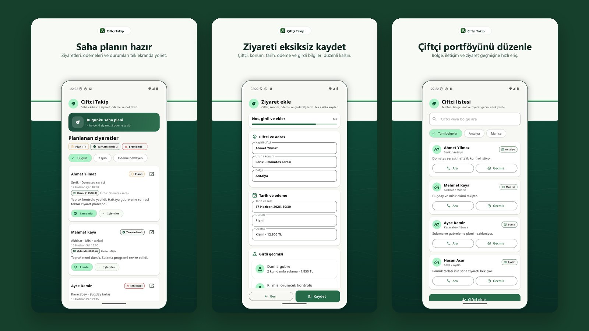
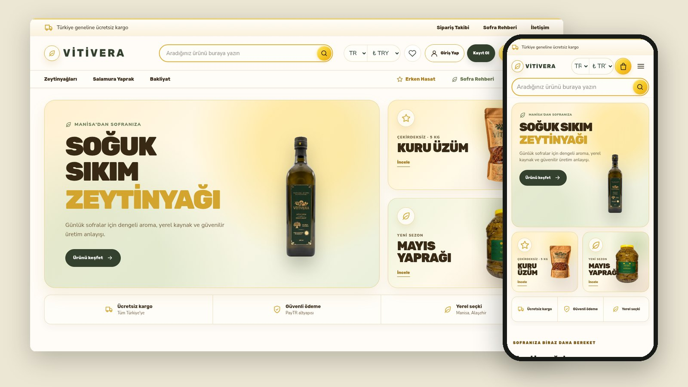
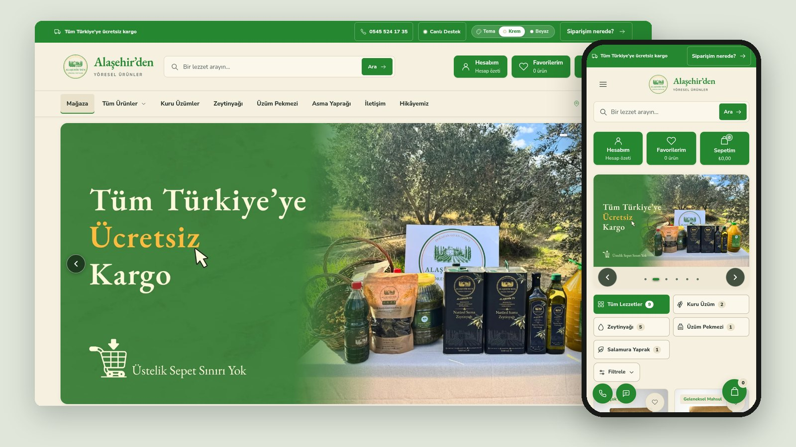
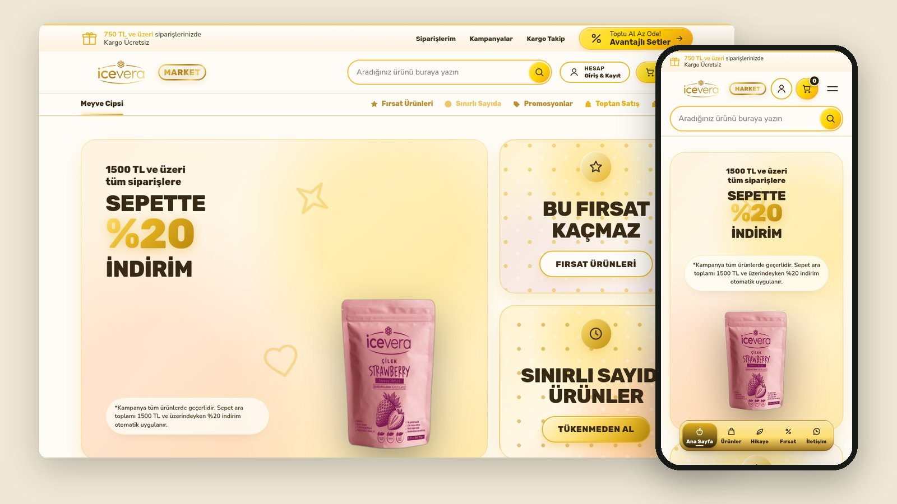
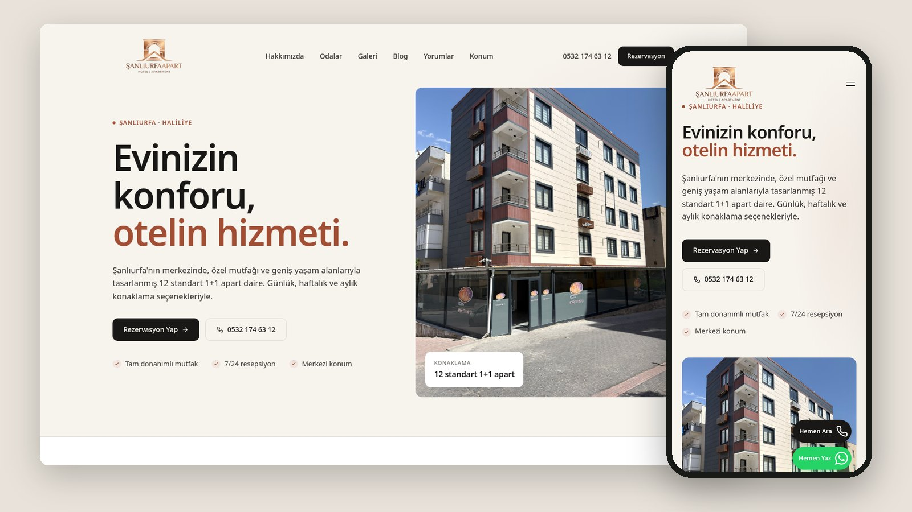

# Muhammet Emre Akyüz

Software engineer at **ES Company Studio**, based in Türkiye. I design and build websites, online stores, mobile apps and custom desktop software for small businesses and independent brands. I do the whole job myself, from the first sketch to the live site, and I stay around for changes after launch.

[escompanystudio.com](https://escompanystudio.com) · [escompanystudio@gmail.com](mailto:escompanystudio@gmail.com) · Open for freelance projects

 

## What I build

<table>
  <tr>
    <td valign="top" width="30%"><b>Websites</b></td>
    <td valign="top">Company sites, landing pages and portfolios that load fast and work well on phones.</td>
  </tr>
  <tr>
    <td valign="top" width="30%"><b>Online stores</b></td>
    <td valign="top">Product catalogue, search, cart, checkout, customer accounts and order tracking, ready to connect to a payment provider such as iyzico, PayTR or Shopier.</td>
  </tr>
  <tr>
    <td valign="top" width="30%"><b>Mobile apps</b></td>
    <td valign="top">Android and iOS apps, from the first screens to the store listing. <a href="https://play.google.com/store/apps/details?id=com.escompanystudio.ciftcitakip">Çiftçi Takip</a> is live on Google Play.</td>
  </tr>
  <tr>
    <td valign="top" width="30%"><b>Desktop and custom software</b></td>
    <td valign="top">Windows applications in C# and .NET, internal tools for your business, and automation for repetitive work.</td>
  </tr>
</table>

 

## Selected work

### Çiftçi Takip, Android app

Field app for agricultural teams, published on Google Play under ES Company Studio. Engineers and dealers log farm visits with GPS location, photos and notes, keep working where there is no signal and sync when they are back online. The app also keeps a farmer portfolio, shares tasks across the team and exports reports as PDF or CSV. I built the app and its product website.

[Google Play](https://play.google.com/store/apps/details?id=com.escompanystudio.ciftcitakip) · [ciftcitakip.com](https://ciftcitakip.com)

### Client websites

<table>
  <tr>
    <td width="50%" valign="top">
      
       <b><a href="https://vitivera.com">Vitivera</a></b>
       Online store for a Manisa brand selling cold-pressed olive oil and brined vine leaves. Next.js, PayTR payments, language and currency switcher, order tracking and a recipe section.
    </td>
    <td width="50%" valign="top">
      
       <b><a href="https://alasehirden.com">Alaşehir'den</a></b>
       Store for regional products from Alaşehir: raisins, vine leaves, olive oil and grape molasses. Category filters, favourites, order tracking, live support and a choice of colour themes.
    </td>
  </tr>
  <tr>
    <td width="50%" valign="top">
      
       <b><a href="https://icevera.com.tr">icevera</a></b>
       Store for a freeze-dried fruit snack brand, built on the ikas platform, with campaign pages, wholesale and subscription sections and a bottom tab bar on phones.
    </td>
    <td width="50%" valign="top">
      
       <b><a href="https://xn--anlurfaapart-34b45d.com/">Şanlıurfa Apart</a></b>
       Website for a 12-unit apart hotel in Şanlıurfa. Rooms, photo gallery, guest reviews, blog and map, with one-tap call and WhatsApp buttons for bookings.
    </td>
  </tr>
</table>

### Demos and personal projects

<table>
  <tr>
    <td width="50%" valign="top">
      
       <b>Gurme Alaşehirden</b>
       Store for a food producer from Alaşehir: 24-product catalogue, product pages, animated cart, demo checkout with order tracking, customer accounts, favourites and a live-support chat demo. Plain HTML, CSS and JavaScript.
       <a href="https://escompanystudio-base.github.io/gurme-alasehirden-demo/">Live demo</a> · <a href="https://github.com/escompanystudio-base/gurme-alasehirden-demo">Source</a>
    </td>
    <td width="50%" valign="top">
      
       <b>Alaşehir Organik</b>
       Storefront for an organic produce shop in Alaşehir, Manisa. Category menu, campaign slider, product pages, cart and a customer account area.
       <a href="https://escompanystudio-base.github.io/alasehir-organik-demo/">Live demo</a> · <a href="https://github.com/escompanystudio-base/alasehir-organik-demo">Source</a>
    </td>
  </tr>
</table>

#### DinamikAda

A Windows 11 utility written in C#, .NET 8 and WPF, with native C++ hooks into `explorer.exe`. It puts a small island at the top of the screen with media controls, system stats and usage limits for AI subscriptions (ChatGPT, Claude, Gemini, Cursor), and turns the taskbar into a floating dock. If your project needs software that works closely with Windows itself, this is the kind of work I do.

[Source and screenshots](https://github.com/escompanystudio-base/DinamikAda)

 

## How I work

- You see a working preview early and we shape it together, instead of waiting for a finished product.
- I write the code myself and hand over the complete source when the project is done.
- Every site is checked on phones, tablets and desktop before delivery.
- After launch I am available for fixes and small updates.

## Tools

<table>
  <tr>
    <td valign="top" width="22%">Web</td>
    <td valign="top">HTML, CSS, JavaScript, TypeScript, React, Next.js, PHP, PostgreSQL</td>
  </tr>
  <tr>
    <td valign="top" width="22%">Mobile</td>
    <td valign="top">Flutter, Dart</td>
  </tr>
  <tr>
    <td valign="top" width="22%">Desktop</td>
    <td valign="top">C#, .NET, WPF, Win32, C++</td>
  </tr>
  <tr>
    <td valign="top" width="22%">Other</td>
    <td valign="top">Python, PowerShell, Git</td>
  </tr>
</table>

## Start a project

Send a few lines about what you need to [escompanystudio@gmail.com](mailto:escompanystudio@gmail.com) or through [escompanystudio.com](https://escompanystudio.com). I will reply with questions, a plan and a price.

 

<b>Türkçe</b>

 

Merhaba, ben Muhammet Emre. ES Company Studio adıyla işletmelere web sitesi, e-ticaret mağazası, mobil uygulama ve özel masaüstü yazılımı hazırlıyorum. Tasarımdan yayına kadar işi kendim yapıyorum, yayından sonra da güncellemeler için ulaşabilirsiniz.

Projeniz için [escompanystudio@gmail.com](mailto:escompanystudio@gmail.com) adresine birkaç satır yazmanız yeterli.

