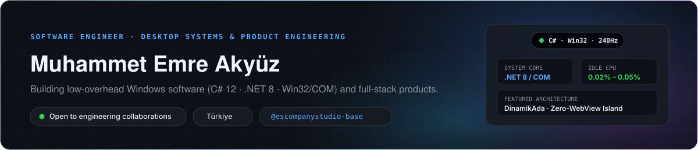
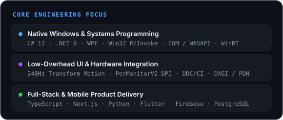
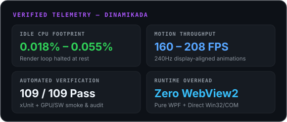

  

  
  
  
  

 

<table>
  <tr>
    <td width="50%" valign="top">
      
    </td>
    <td width="50%" valign="top">
      
    </td>
  </tr>
</table>

## Featured Engineering · [DinamikAda](https://github.com/escompanystudio-base/DinamikAda)

**Windows 11 Dynamic Island Control Deck** engineered from scratch with **C# 12**, **.NET 8**, **WPF**, and direct **Win32 / COM / WinRT** interop — built with zero Electron or WebView2 overhead.

<table>
  <tr>
    <td width="60%" valign="top">
      
    </td>
    <td width="40%" valign="top">
      
        
      <ul>
        <li><b>Audio &amp; Media:</b> GSMTC session switcher, dynamic album silk aura, WASAPI per-app mixer &amp; WAV voice notes.</li>
        <li><b>Display &amp; Systems:</b> DDC/CI brightness + Night-Light-safe Win32 <code>WS_POPUP</code> dimmer, real PDH/DXGI GPU telemetry.</li>
        <li><b>Productivity:</b> DPAPI clipboard vault, region screenshot + WinRT OCR, QR LAN file drops &amp; command palette.</li>
      </ul>
      
<a href="https://github.com/escompanystudio-base/DinamikAda"><b>Explore DinamikAda Source →</b></a>

    </td>
  </tr>
</table>

## Engineering Principles

| Architecture | Performance | Verification |
|---|---|---|
| Clean modular boundaries separating Win32/COM interop from application logic. | Zero-allocation hot paths, GPU transform motion, and automatic idle render halting. | Automated xUnit suites, headless runtime smoke probes, and visual render audits. |

## Core Stack

  
  
  
  
  
  
  
  

  Muhammet Emre Akyüz · <a href="mailto:escompanystudio@gmail.com">escompanystudio@gmail.com</a> · Türkiye

