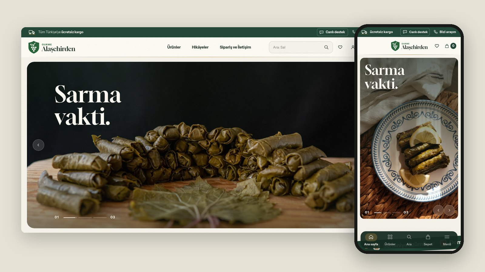
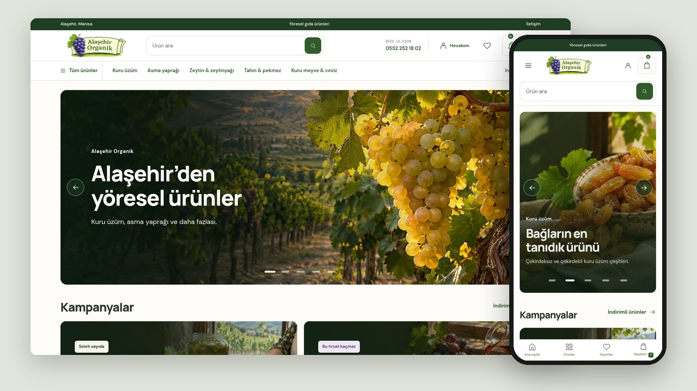

# Muhammet Emre Akyüz

Software engineer at **ES Company Studio**, based in Türkiye. I design and build websites, online stores, mobile apps and custom desktop software for small businesses and independent brands. I do the whole job myself, from the first sketch to the live site, and I stay around for changes after launch.

[escompanystudio.com](https://escompanystudio.com) · [escompanystudio@gmail.com](mailto:escompanystudio@gmail.com) · Open for freelance projects

 

## What I build

<table>
  <tr>
    <td valign="top" width="30%"><b>Websites</b></td>
    <td valign="top">Company sites, landing pages and portfolios that load fast and work well on phones.</td>
  </tr>
  <tr>
    <td valign="top" width="30%"><b>Online stores</b></td>
    <td valign="top">Product catalogue, search, cart, checkout, customer accounts and order tracking, ready to connect to a payment provider such as iyzico, PayTR or Shopier.</td>
  </tr>
  <tr>
    <td valign="top" width="30%"><b>Mobile apps</b></td>
    <td valign="top">iOS and Android apps built with Flutter.</td>
  </tr>
  <tr>
    <td valign="top" width="30%"><b>Desktop and custom software</b></td>
    <td valign="top">Windows applications in C# and .NET, internal tools for your business, and automation for repetitive work.</td>
  </tr>
</table>

 

## Selected work

### Gurme Alaşehirden

Online store for a food producer from Alaşehir selling vine leaves, raisins, tomato paste and olives. It has a 24-product catalogue with search and category filters, product pages, an animated cart, a demo checkout with order tracking, customer accounts, favourites, full-screen search on mobile and a live-support chat demo. Plain HTML, CSS and JavaScript with no framework, hosted on GitHub Pages.

[Live demo](https://escompanystudio-base.github.io/gurme-alasehirden-demo/) · [Source](https://github.com/escompanystudio-base/gurme-alasehirden-demo)

### Alaşehir Organik

Storefront for an organic produce shop in Alaşehir, Manisa. Category menu, campaign slider, product cards and detail pages, cart and a customer account area. On phones the navigation moves to a bottom tab bar.

[Live demo](https://escompanystudio-base.github.io/alasehir-organik-demo/) · [Source](https://github.com/escompanystudio-base/alasehir-organik-demo)

### DinamikAda

A Windows 11 utility written in C#, .NET 8 and WPF, with native C++ hooks into `explorer.exe`. It puts a small island at the top of the screen with media controls, system stats and usage limits for AI subscriptions (ChatGPT, Claude, Gemini, Cursor), and turns the taskbar into a floating dock. If your project needs software that works closely with Windows itself, this is the kind of work I do.

[Source and screenshots](https://github.com/escompanystudio-base/DinamikAda)

 

## How I work

- You see a working preview early and we shape it together, instead of waiting for a finished product.
- I write the code myself and hand over the complete source when the project is done.
- Every site is checked on phones, tablets and desktop before delivery.
- After launch I am available for fixes and small updates.

## Tools

<table>
  <tr>
    <td valign="top" width="22%">Web</td>
    <td valign="top">HTML, CSS, JavaScript, TypeScript, React, Next.js, PHP, PostgreSQL</td>
  </tr>
  <tr>
    <td valign="top" width="22%">Mobile</td>
    <td valign="top">Flutter, Dart</td>
  </tr>
  <tr>
    <td valign="top" width="22%">Desktop</td>
    <td valign="top">C#, .NET, WPF, Win32, C++</td>
  </tr>
  <tr>
    <td valign="top" width="22%">Other</td>
    <td valign="top">Python, PowerShell, Git</td>
  </tr>
</table>

## Start a project

Send a few lines about what you need to [escompanystudio@gmail.com](mailto:escompanystudio@gmail.com) or through [escompanystudio.com](https://escompanystudio.com). I will reply with questions, a plan and a price.

 

<b>Türkçe</b>

 

Merhaba, ben Muhammet Emre. ES Company Studio adıyla işletmelere web sitesi, e-ticaret mağazası, mobil uygulama ve özel masaüstü yazılımı hazırlıyorum. Tasarımdan yayına kadar işi kendim yapıyorum, yayından sonra da güncellemeler için ulaşabilirsiniz.

Projeniz için [escompanystudio@gmail.com](mailto:escompanystudio@gmail.com) adresine birkaç satır yazmanız yeterli.

